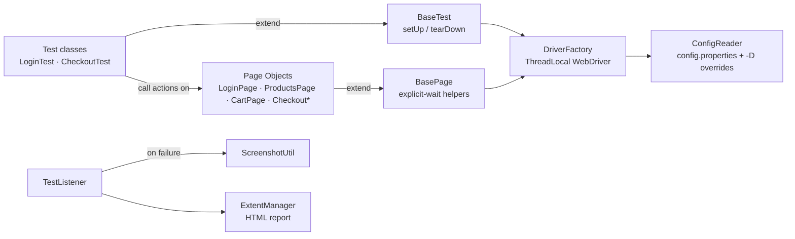

# SauceDemo UI Automation Framework

[](https://github.com/AishwaryaAni/saucedemo-selenium-framework/actions/workflows/ui-tests.yml)


A maintainable, CI-ready web UI automation framework built with **Java, Selenium WebDriver 4 and TestNG**, using the **Page Object Model**. It automates the core e-commerce journey of [SauceDemo](https://www.saucedemo.com/) — login, add to cart, checkout and order confirmation — plus data-driven negative login coverage.

> Built by  Aishwarya Anil QA Lead with 6 years of manual, API and database testing. The design goal: every automated check should read like the manual test case it replaces.

---

## Highlights

- **Page Object Model** with a fluent API — tests read as a user journey: `openApp().loginAs(...).addToCart(...).openCart()`
- **Zero `Thread.sleep()`** — all synchronisation through explicit waits centralised in `BasePage`
- **Parallel-safe** — `ThreadLocal<WebDriver>` gives each thread its own browser
- **Cross-browser** — Chrome, Firefox, Edge; headed or headless; drivers auto-resolved by Selenium Manager
- **Config without code changes** — any setting can be overridden from the command line (`-Dbrowser=firefox`)
- **Data-driven tests** with TestNG `@DataProvider`
- **Evidence on failure** — automatic screenshot attached to an Extent HTML report
- **Smoke vs regression** suites via TestNG groups
- **CI pipeline** on GitHub Actions — runs on every push/PR and publishes the report as a build artifact

---

## Tech Stack

| Layer | Tool |
|---|---|
| Language | Java 17 |
| Browser automation | Selenium WebDriver 4 (Selenium Manager) |
| Test runner & assertions | TestNG 7 (`Assert`, `SoftAssert`, `@DataProvider`, groups, parallel) |
| Build & dependencies | Maven (Surefire) |
| Reporting | ExtentReports 5 (Spark HTML) |
| Logging | Log4j 2 |
| CI/CD | GitHub Actions (headless Chrome) |

---

## Architecture



**Layers and responsibilities**

| Layer | Responsibility | Never does |
|---|---|---|
| **Tests** | Describe *what* is verified; hold assertions | Touch locators or `WebDriver` directly |
| **Page Objects** | Describe *how* to interact with a screen; own locators | Assert business outcomes |
| **BasePage** | Waits + safe wrappers (`click`, `type`, `getText`) | Know about any specific page |
| **DriverFactory** | Create / share / quit browsers per thread | Hold test logic |
| **Listener / Reporting** | Log results, capture screenshots | Influence pass/fail |

---

## Project Structure

```
saucedemo-selenium-framework
├── .github/workflows/ui-tests.yml        # CI pipeline
├── pom.xml
└── src
    ├── main/java/com/qa/framework
    │   ├── config/ConfigReader.java       # properties + -D overrides
    │   ├── driver/DriverFactory.java      # ThreadLocal driver, browser options
    │   ├── listeners/TestListener.java    # TestNG hooks → report + screenshots
    │   ├── reporting/ExtentManager.java   # Extent HTML report
    │   ├── utils/ScreenshotUtil.java
    │   └── pages
    │       ├── BasePage.java              # explicit-wait helpers
    │       ├── LoginPage.java
    │       ├── ProductsPage.java
    │       ├── CartPage.java
    │       ├── CheckoutInfoPage.java
    │       ├── CheckoutOverviewPage.java
    │       └── CheckoutCompletePage.java
    └── test
        ├── java/com/qa/framework
        │   ├── base/BaseTest.java
        │   └── tests
        │       ├── LoginTest.java
        │       └── CheckoutTest.java
        └── resources
            ├── config.properties
            ├── testng.xml                 # full regression (parallel)
            ├── testng-smoke.xml           # smoke subset
            └── log4j2.xml
```

---

## Test Coverage

| Test | Type | Group | What it verifies |
|---|---|---|---|
| `validUserCanLogin` | Positive | smoke, regression | Redirect to inventory; page title is "Products" |
| `invalidLoginShowsError` ×4 | Negative, data-driven | regression | Locked-out user, wrong password, empty username, empty password each show the exact error and block access |
| `userCanCompletePurchase` | End-to-end | smoke, regression | Cart badge count, cart contents, subtotal = sum of line items, total = subtotal + tax, order confirmation |

### From manual test case to automated check

| Manual step | Automated equivalent |
|---|---|
| "Wait until the page loads" | `WebDriverWait` + `ExpectedConditions` in `BasePage` |
| "Verify the error message reads …" | `Assert.assertEquals(actual, expected, "Error message text")` |
| "Check all price fields, log every mismatch" | `SoftAssert` → `assertAll()` |
| Same steps, different input rows | TestNG `@DataProvider` |
| Attach screenshot to the defect | `TestListener.onTestFailure` → screenshot in report |
| Smoke vs full regression run | TestNG groups + two suite files |

---

## Getting Started

### Prerequisites

- **JDK 17+** — `java -version`
- **Maven 3.8+** — `mvn -v`
- **Google Chrome** (or Firefox / Edge). No manual driver download — Selenium Manager handles it.

### Clone and run

```bash
git clone https://github.com/AishwaryaAni/saucedemo-selenium-framework.git
cd saucedemo-selenium-framework

# Full regression on Chrome (default)
mvn clean test
```

### Common run options

```bash
# Headless (no browser window) — same as CI
mvn clean test -Dheadless=true

# Another browser
mvn clean test -Dbrowser=firefox
mvn clean test -Dbrowser=edge

# Smoke suite only
mvn clean test -Dsuite=testng-smoke.xml

# Single test class
mvn clean test -Dtest=CheckoutTest
```

### Run from an IDE

Open the project in IntelliJ IDEA or Eclipse as a Maven project, then right-click `src/test/resources/testng.xml` → **Run**.

---

## Reports & Artifacts

After a run:

| Output | Location |
|---|---|
| Extent HTML report | `target/extent-report/index.html` |
| Failure screenshots | `target/screenshots/` |
| Execution log | `target/logs/test-run.log` |
| TestNG / Surefire reports | `target/surefire-reports/` |

On GitHub Actions, the same files are uploaded as the **test-report** artifact on every run (pass or fail).

---

## Configuration

`src/test/resources/config.properties`

| Key | Default | Override example |
|---|---|---|
| `baseUrl` | `https://www.saucedemo.com/` | `-DbaseUrl=https://staging.example.com/` |
| `browser` | `chrome` | `-Dbrowser=firefox` |
| `headless` | `false` | `-Dheadless=true` |
| `explicit.wait` | `10` (s) | `-Dexplicit.wait=15` |
| `page.load.timeout` | `30` (s) | `-Dpage.load.timeout=60` |

Command-line values always win over the file, so CI and local runs share one config.

---

## Design Decisions

- **Implicit wait is set to 0.** Mixing implicit and explicit waits causes unpredictable timeouts; this framework uses explicit waits only.
- **New browser per test method.** Slightly slower, but removes test-order dependencies and makes parallel runs reliable.
- **Locators use `data-test` attributes** where the app provides them — they are stable across UI restyling, unlike CSS classes or XPath.
- **Money is compared as `BigDecimal`**, not `double`, to avoid floating-point false failures in price assertions.
- **Page Objects return the next page**, so an invalid navigation fails at the step where it happens, not three steps later.

---

## Roadmap

- [ ] REST Assured API layer (create test data via API, verify via UI)
- [ ] Selenium Grid / Docker for distributed cross-browser runs
- [ ] Allure reporting
- [ ] Test data from JSON / Excel
- [ ] Retry analyzer for known-flaky environment issues

---

## Author

**Aishwarya Anil** — Senior QA Engineer · QA Team Lead
Manual · API · Database · UI Automation

[LinkedIn](https://linkedin.com/in/aishwarya-anil20) · [GitHub](https://github.com/AishwaryaAni)
